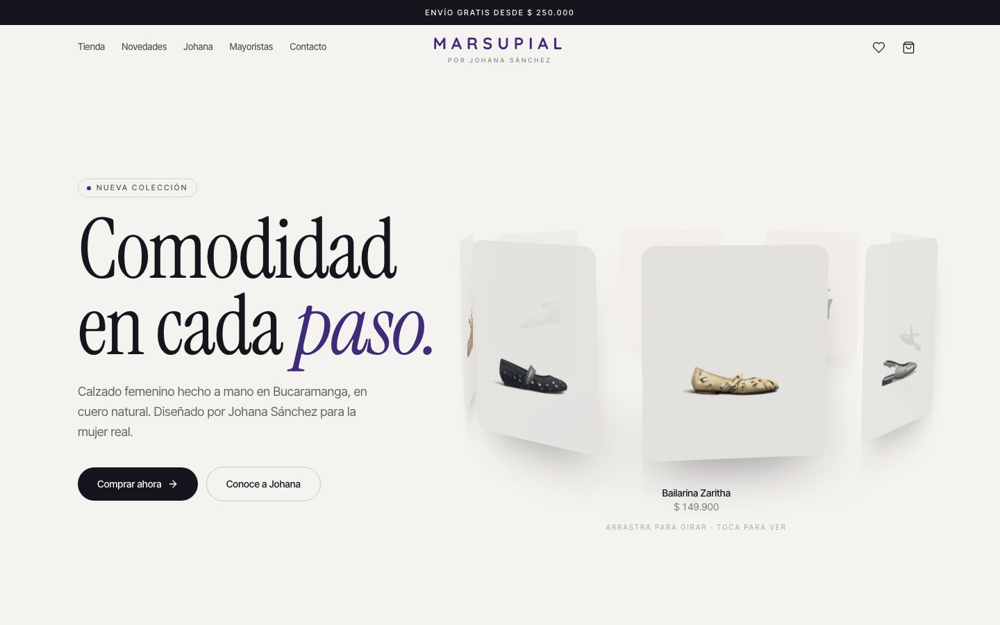
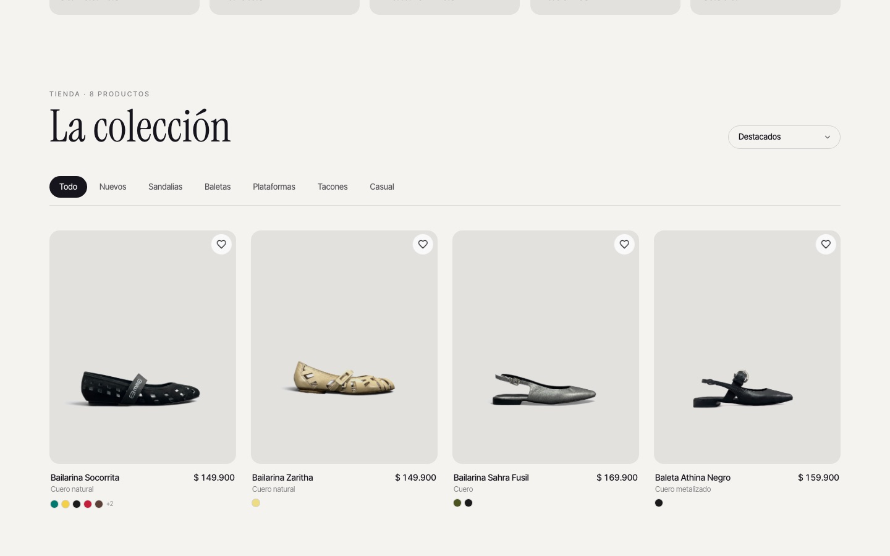
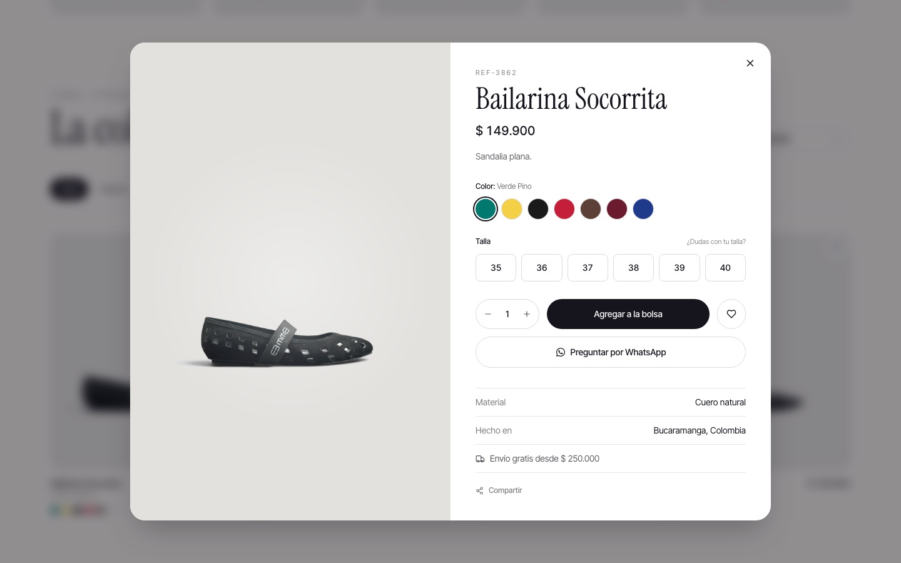
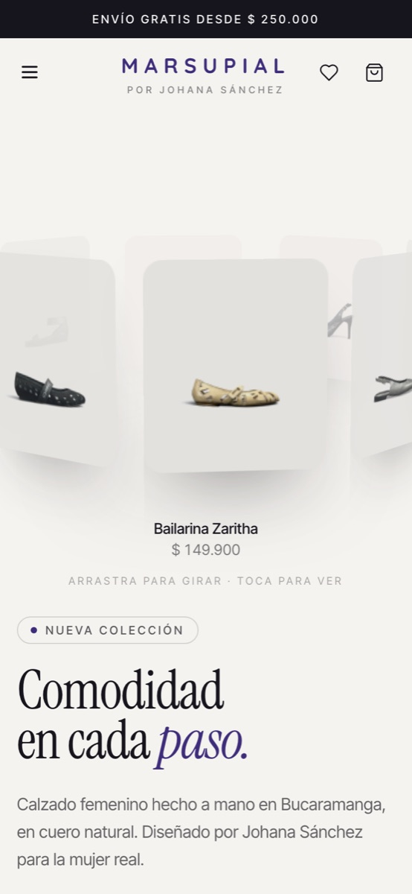
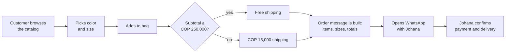

<div align="center">

# Marsupial · Online store

**The online store for Marsupial, a women's footwear brand from Bucaramanga, Colombia.**
Designed and built end to end by [Santiago Delgado](https://santi-portafolio.vercel.app) for Johana Sánchez.

[**View the live site →**](https://johana-marsupial-portfolio.vercel.app)




</div>

## At a glance

| | |
|---|---|
| **Client** | Marsupial — a family footwear workshop with 20+ years of history and 1,000+ pairs a month |
| **Goal** | Let customers browse the full collection on their own and send a complete order in one tap |
| **Solution** | A fast catalog-and-cart storefront that turns a cart into a ready-to-send WhatsApp order |
| **My role** | Sole developer: design, front-end, content structure, deployment |
| **Status** | Live on Vercel, with a wholesale section for brands and resellers |

## What a customer can do

| Browse | Choose | Order |
|---|---|---|
|  |  |  |
| Filter by style (sandals, flats, heels…) or "new", and sort by price or name | Pick color and size, see material and origin, save favorites, share the product | Review the bag, see shipping, and send the order to Johana on WhatsApp in one tap |

## How an order works

There is no payment gateway on purpose. The business already closes sales over WhatsApp, so the site's job is to deliver a complete, correctly formatted order to that conversation.



The message that arrives looks like this:

```text
Hola Johana, quiero hacer este pedido en Marsupial:

• 1 x Bailarina Socorrita (REF-3862) · Verde Pino · Talla 37 — $ 149.900
• 1 x Cuña Athina Miel (REF-3887) · Miel · Talla 38 — $ 209.900

Subtotal: $ 359.800
Envío: Gratis
Total: $ 359.800
```

## Keeping it up to date (no developer needed)

<details>
<summary><b>Add or edit a product</b></summary>

<br/>

All products live in one file: [`src/data/productos.json`](src/data/productos.json). Add an entry, upload the photo to `public/productos/zapatos/`, and push. Vercel redeploys automatically.

```json
{
  "id": "ref-3862",
  "referencia": "REF-3862",
  "nombre": "Bailarina Socorrita",
  "categoria": "zapatos",
  "subcategoria": "sandalias",
  "descripcion": "Sandalia plana.",
  "precio": 149900,
  "colores": [{ "nombre": "Verde Pino", "hex": "#01796F" }],
  "tallas": [35, 36, 37, 38, 39, 40],
  "material": "Cuero natural",
  "destacado": true,
  "nuevo": false,
  "fotos": ["/productos/zapatos/socorritas.jpeg"]
}
```

| Field | What it controls |
|---|---|
| `precio` | Price in COP. Leave it out to show "Consultar" instead |
| `subcategoria` | Which filter tab the product appears under |
| `destacado` | Shows the product in the home page carousel |
| `nuevo` | Adds the "Nuevo" badge and the "Nuevos" filter |

</details>

<details>
<summary><b>Change the WhatsApp number or shipping rules</b></summary>

<br/>

Everything is in [`src/lib/shop.js`](src/lib/shop.js):

```js
export const WHATSAPP_NUMBER = "573174385716"; // where orders are sent
export const ENVIO_GRATIS_DESDE = 250000;      // free shipping from this subtotal (COP)
export const COSTO_ENVIO = 15000;              // shipping cost below that
```

</details>

## Under the hood

<details>
<summary><b>Tech stack and why</b></summary>

<br/>

| Layer | Choice | Why |
|---|---|---|
| UI | React 18 + Vite | Fast builds and instant local reloads for a small, content-heavy site |
| Styling | Tailwind CSS v4 | One consistent visual system across the store and the brand sections |
| State | Zustand (+ `persist`) | Cart and favorites survive a page reload with a tiny store and no boilerplate |
| Motion | Framer Motion | Product sheet, bag drawer and carousel transitions, with reduced-motion respected |
| Forms | React Hook Form + Zod + Formspree | Validated contact form without running a backend |
| Hosting | Vercel | Every push to `main` is live in about a minute |

</details>

<details>
<summary><b>Engineering decisions</b></summary>

<br/>

- **No backend, no database.** The catalog is a versioned JSON file. For 8–50 products this is simpler, free to host, and every change is reviewable in Git.
- **WhatsApp instead of a payment gateway.** It matches how the business already sells and avoids processing fees and card handling.
- **Cart keyed by product + color + size.** The same shoe in two sizes becomes two lines, which is exactly what the workshop needs to fulfill the order.
- **Persistent cart.** Stored in `localStorage` under `marsupial-shop`, so customers who leave and come back don't lose their bag.
- **Native share.** The product sheet uses the Web Share API on phones, so customers can send a shoe to a friend through any app.
- **3D carousel without a 3D engine.** The home carousel is built with CSS transforms and pointer events (drag to rotate, tap to open), so it stays light on mobile.

</details>

<details>
<summary><b>Project structure</b></summary>

<br/>

```
src/
├── pages/                 Home and 404
├── components/
│   ├── shop/              Header, 3D carousel, catalog, product sheet, bag drawer, footer
│   ├── ContactSection     Validated contact form (Formspree)
│   └── PartnersSection    Wholesale and brand partners
├── data/productos.json    The whole catalog
├── lib/shop.js            Prices, shipping rules, WhatsApp order message
└── shopStore.js           Cart, favorites and UI state (Zustand)
public/productos/          Product photos
```

</details>

<details>
<summary><b>Run it locally</b></summary>

<br/>

Requires Node.js 18+.

```bash
git clone https://github.com/Santi2307/johana-marsupial-portfolio.git
cd johana-marsupial-portfolio
npm install
npm run dev        # http://localhost:5173
```

`npm run build` creates the production bundle; `npm run preview` serves it.

</details>

---

<div align="center">
<sub>Built by <a href="https://santi-portafolio.vercel.app">Santiago Delgado</a> · Product photos and brand © Marsupial</sub>
</div>
